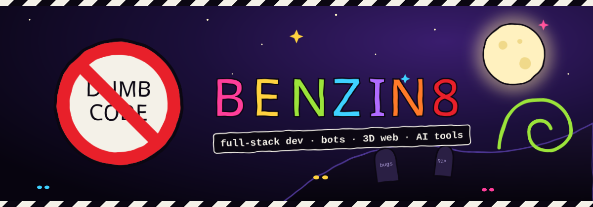

<div align="center">



<a href="https://github.com/benzin8">
  
</a>

</div>

---

### 🎪 `whoami`

```ts
const benzin8 = {
  role:      "full-stack developer",
  builds:    ["Telegram bots", "AI / MCP tools", "3D web apps", "music tools"],
  backend:   ["Python", "Node.js", "Fastify", "Prisma", "PostgreSQL"],
  frontend:  ["React", "TypeScript", "three.js"],
  motto:     "don't code dumb",
};
```

### 🧰 Tech Stack

<p align="center">
  
</p>

### 🐍 Contribution Snake

<p align="center">
  <picture>
    <source media="(prefers-color-scheme: dark)" srcset="https://raw.githubusercontent.com/benzin8/benzin8/output/snake-dark.svg"/>
    <source media="(prefers-color-scheme: light)" srcset="https://raw.githubusercontent.com/benzin8/benzin8/output/snake-light.svg"/>
    
  </picture>
</p>

### 📡 Find Me

<p align="center">
  <a href="https://github.com/benzin8"></a>
  
</p>


